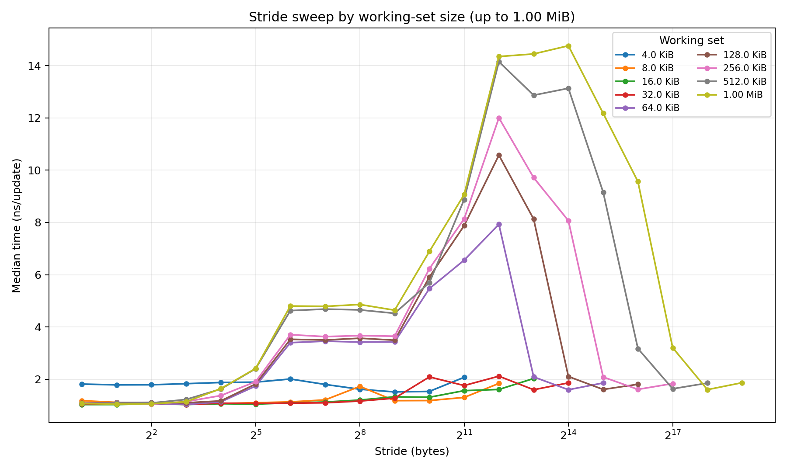
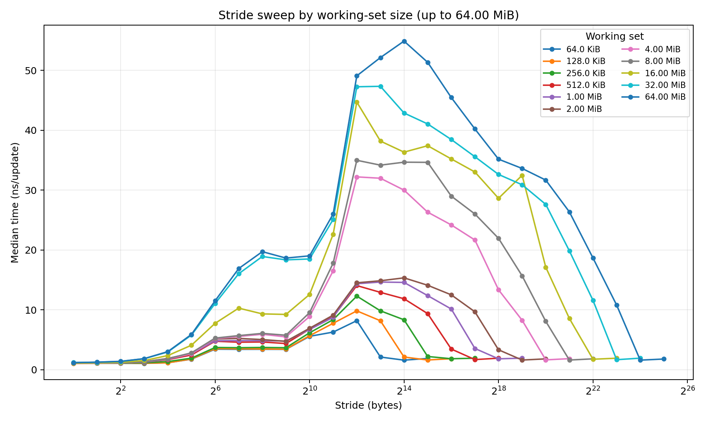
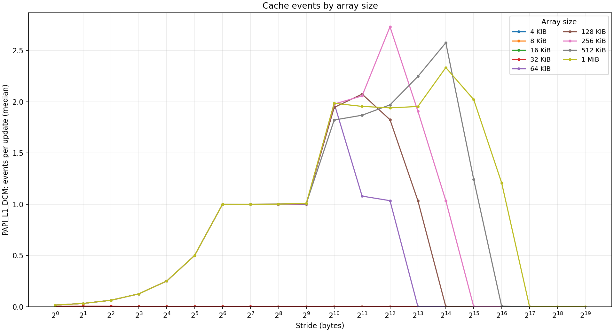
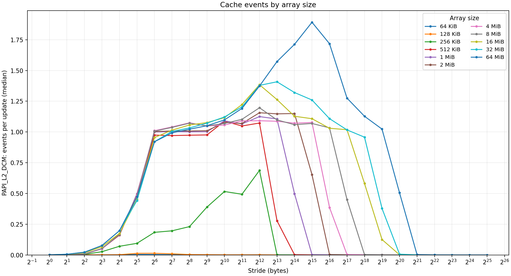
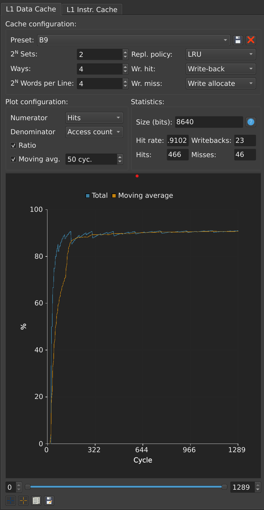

# **LEIC - Organização de Computadores (2026/2027)**
## **Laboratory Assignment 1: System Profiling and Modeling**

---

## **Section 2: Exploring Cache Behaviour Through Timing**

### **Question a) Experimental Environment**

* **Processor model:** Intel(R) Xeon(R) CPU E5-2650 0 @ 2.00GHz
* **Operating system:** NixOS 25.05 (Warbler)
* **Compiler version:** GCC 14.2.1
* **Compilation options:** `-O2 -std=gnu11 -Wall -Wextra`

---

### **Question b) 16 KiB Array Access Pattern**

| Stride (bytes) | First four byte offsets accessed | Number of elements updated per pass |
| :--- | :--- | :--- |
| 1 | 0, 1, 2, 3 | 16,384 |
| 32 | 0, 32, 64, 96 | 512 |
| 64 | 0, 64, 128, 192 | 256 |

**Explanation:** The calculations above are based on an array size of 16,384 bytes (16 KiB). The first four byte offsets follow the sequence 0, $s$, $2s$, and $3s$, where $s$ is the access stride. The total number of elements updated per pass is determined by dividing the total array size by the stride ($N/s$), demonstrating that as the stride increases, fewer memory locations are accessed within a single pass across the working set.

---

### **Question c) L1 Data-Cache Capacity Estimate**

  
  
<em>Figure 1: Median time per update (ns) vs. stride (bytes) across working set sizes up to 1.00 MiB.</em>

* **Estimate:** 32 KiB
* **Justification:** By analyzing the plot and the summary table, arrays up to 32 KiB maintain a consistently low execution time (e.g., 1.09 ns/update at a 64-byte stride). When the working set increases to 64 KiB, there is a distinct, sustained upward shift in the execution time (jumping to 3.40 ns/update at the same 64-byte stride). This sharp increase indicates that the 64 KiB array no longer fits entirely within the L1 data cache, resulting in capacity misses and forcing the CPU to retrieve data from the slower L2 cache.

---

### **Question d) L2 Data-Cache Capacity Sweep**

* **Minimum array size used:** 64 KiB  
* **Maximum array size used:** 64 MiB  

  
  
<em>Figure 2: Stride sweep by working-set size for L2 investigation (64 KiB to 64 MiB).</em>

* **Estimated L2 Capacity:** 256 KiB (or interval [256 KiB, 512 KiB])

**Justification:**  
Comparing the timing curves across working set sizes at identical strides reveals that working sets of 64 KiB, 128 KiB, and 256 KiB exhibit almost identical, low execution times (e.g., ~3.43 ns to 3.71 ns at a 64 B stride). When the array size increases from 256 KiB to 512 KiB, a clear, sustained jump in execution time occurs across all measured strides (e.g., increasing from 3.71 ns to 4.76 ns at 64 B stride, and from 12.30 ns to 14.06 ns at 4 KiB stride). This sustained rise indicates that array sizes exceeding 256 KiB can no longer fit within the L2 data cache and must be retrieved from the slower L3 cache or main memory. This 256 KiB estimate aligns with the per-core L2 cache hardware specification of the Intel Xeon E5-2650 processor.

---

### **Question e) L1 Data-Cache Line Size Estimate**

* **Selected Array Size:** 128 KiB (Larger than the 32 KiB L1 capacity, smaller than the 256 KiB L2 capacity).
* **Estimated L1 Cache Line Size:** 64 bytes.

**Justification:**  
As the stride increases, spatial reuse within a fetched cache line decreases, causing the time per update to rise. Once the stride is equal to or greater than the cache line size, every update requires fetching a new line, causing the execution time to plateau. 

Looking at the 128 KiB working set, the median time per update rises from 1.17 ns at a 16 B stride, to 1.82 ns at a 32 B stride, and reaches 3.53 ns at a 64 B stride. For strides of 128 B, 256 B, and 512 B, the time plateaus at approximately 3.50 ns. This identical plateau pattern at 64 B is also visible on the 64 KiB and 256 KiB working sets. Because the time per update stops rising at a stride of 64 bytes, it indicates that spatial reuse has been fully exhausted, confirming a cache line size of 64 bytes.

---

## **Section 3: Exploring Cache Behaviour Through Hardware Counters**

### **Question a) Experimental Environment & Event Details**

* **Processor model:** Intel(R) Xeon(R) CPU E5-2650 0 @ 2.00GHz
* **Operating system:** NixOS 25.05 (Warbler) / Linux 6.12.40
* **Compiler version:** GCC 14.2.1
* **Compilation options:** `-O2 -std=c11 -Wall -Wextra`

**L1 Event Used:** `PAPI_L1_DCM`  
* **Short Description:** L1D cache misses
* **Native Event Description:** Number of cache lines brought into the L1D cache (L1D:REPLACEMENT)

**L2 Event Used:** `PAPI_L2_DCM`  
* **Short Description:** L2D cache misses
* **Native Event Description:** Core-originated cacheable demand requests to L3 (LAST_LEVEL_CACHE_REFERENCES)

---

### **Question b) L1 Data-Cache Capacity Estimate**

  

* **Estimated L1 Capacity:** **32 KiB**
* **Array-size range used:** 4 KiB to 1 MiB

**Explanation:**
The hardware counter data demonstrates a precise capacity boundary. For working sets up to 32 KiB, the L1 miss ratio is practically zero (e.g., ~0.002 misses per update at a 64-byte stride), indicating the array fits entirely within the cache. When the working set size increases to 64 KiB, the miss ratio abruptly jumps to exactly 1.0 at the same 64-byte stride. This step-function increase proves that the 64 KiB array exceeds the L1 capacity, causing every cache line accessed during an update pass to result in a capacity miss.

---

### **Question c) L2 Data-Cache Capacity Estimate**

  

* **Estimated L2 Capacity:** **256 KiB** (interval [256 KiB, 512 KiB])
* **Array-size range used:** 64 KiB to 64 MiB

**Explanation:**
The hardware counter data for `PAPI_L2_DCM` clearly illustrates the L2 cache capacity boundary. For working sets of 64 KiB, 128 KiB, and 256 KiB, the L2 miss ratio remains low (e.g., approximately 0.18 misses per update at a 64-byte stride for the 256 KiB array). This indicates that while these arrays exceed the L1 capacity, they still fit comfortably within the L2 cache. However, when the working set size doubles to 512 KiB, the L2 miss ratio spikes to approximately 0.97 misses per update at the same 64-byte stride. This dramatic, near-complete miss rate proves that array sizes exceeding 256 KiB can no longer fit in the L2 cache, forcing the processor to evict data and fetch it from the slower L3 cache or main memory.

---

### **Question d) L1 Data-Cache Line Size Estimate**

* **Selected Array Size:** **128 KiB** *(Chosen because it is strictly larger than the 32 KiB L1 capacity, but smaller than the 256 KiB L2 capacity).*
* **Estimated L1 Cache Line Size:** **64 bytes**

**Explanation:**
To estimate the cache line size, we analyze the relationship between the access stride and spatial locality. The data for the 128 KiB array demonstrates that the L1 miss ratio strictly scales as the stride doubles: at a 16-byte stride the median miss ratio is $\approx 0.25$, and at a 32-byte stride it is $\approx 0.50$. Once the stride reaches 64 bytes, the miss ratio reaches exactly $\approx 1.0$ and plateaus at that value for larger strides (128 bytes, 256 bytes). This plateau indicates that spatial reuse within a fetched memory block has been fully exhausted at a 64-byte offset, confirming that the hardware fetches data in exact 64-byte cache lines.

---

### **Question e) Justification & Comparison**

**Capacity and Line Size Justifications:**
* **L1 Capacity (32 KiB):** For arrays up to 32 KiB, the L1 miss ratio remains near zero (e.g., ~0.002 misses per update at a 64 B stride). When the array doubles to 64 KiB, the miss ratio jumps abruptly to 1.0 at the same 64 B stride, proving the data no longer fits in the L1 cache.
* **L2 Capacity (256 KiB):** For arrays up to 256 KiB, the L2 miss ratio remains low (e.g., ~0.18 at a 64 B stride). At 512 KiB, it spikes to ~0.97 misses per update at the same stride, confirming the 256 KiB L2 boundary.
* **L1 Line Size (64 bytes):** Using the 128 KiB array, the L1 miss ratio doubles as the stride doubles: ~0.25 at 16 B, ~0.50 at 32 B, and reaches exactly 1.0 at a 64 B stride. The miss ratio plateaus at 1.0 for all larger strides (128 B, 256 B), proving spatial reuse is exhausted at 64 bytes. 

**Comparison with Section 2:**
Both experiments were conducted on the same Intel Xeon E5-2650 machine (lab computer via ssh). The conclusions from both sections are in perfect agreement: L1 capacity is 32 KiB, L2 capacity is 256 KiB, and the cache line size is 64 bytes. 

However, the hardware-counter measurements made the transitions significantly clearer. The timing measurements in Section 2 produced curves with gradual slopes due to the overlapping latency of CPU pipelining, out of order execution, loop overhead, and other noise. In contrast, the hardware counters measured the exact physical cache evictions, producing sharp step function graphs that provided mathematical certainty (e.g., jumping exactly from 0 to 1.0 misses per update) without timing ambiguity. There were no disagreements between the two methodologies.

---

## **Section 4: Exploring Cache Design with Ripes**

### **Workload and Memory-Access Pattern:**

The supplied `workload.asm` was used without changing its instructions or memory layout. The assembly reserves a 2048-byte buffer and places the four arrays at fixed offsets from its beginning. Each integer is a four-byte word.

| Array | Starting byte offset from `buffer` | Elements accessed | Successive access distance | Operations in loop 1 | Operations in loop 2 |
| :--- | ---: | :--- | ---: | :--- | :--- |
| `a` | 0 | `a[0]` to `a[63]` | 4 bytes | Write 123 | Write `b[i] + 567` |
| `b` | 256 | `b[0]` to `b[63]` | 4 bytes | Write 234 | Read |
| `c` | 512 | `c[0]` to `c[63]` | 4 bytes | Write 345 | Write `d[3*i] + 678` |
| `d` | 768 | `d[0], d[3], ..., d[189]` | 12 bytes | Write 456 | Read |

The first loop performs four stores per iteration for 64 iterations, giving 256 data-cache accesses. The second loop performs two loads and two stores per iteration for another 256 accesses. A complete execution therefore contains **512 data accesses: 128 reads and 384 writes**. These are the data accesses being compared; instruction fetches belong to the separate instruction cache.

The workload exhibits both spatial and temporal locality. Consecutive elements of `a`, `b`, and `c` can reuse a fetched cache line. The stride of three integers in `d` skips two words between accesses, reducing this opportunity. The second loop revisits the data written by the first, providing potential temporal reuse if the required lines have survived in the cache.

---

### **Experimental Setup and Interpretation of Parameters:**

* **Simulator:** Ripes, browser version at https://ripes.dk/.
* **Exact Ripes version/build:** **v2.2.6-106-g5b8a616**
* **Processor:** 32-bit RISC-V single-cycle processor.
* **Cache under investigation:** L1 data cache; instruction-cache settings were left unchanged.
* **Program:** the supplied `workload.asm`, unchanged.
* **Measurement procedure:** configure the data cache, reset execution and cache contents/statistics, and execute the complete program once. Both loops are included, with no warm-up run. The totals below are consistent with one complete execution: hits plus misses equals 512 in every case.

A cache has $S$ sets, $A$ ways (cache lines per set), and $W$ four-byte words per line. Its number of lines is $SA$, its line size is $4W$ bytes, and its data capacity is:

$$
C = S \times A \times W \times 4 \quad \text{bytes}.
$$

The fields labelled $2^n$ in the supplied screenshots are **Sets** and **Words per Line**. Their displayed values must be converted from exponents: 5 sets means $2^5=32$ sets, 4 means 16 sets, 0 means one set, and 2 words per line means four words. In these screenshots, **Ways is displayed as an ordinary count**, without the $2^n$ label. Therefore a displayed Ways value of 5 means **five ways**, and a value of 1 means **one way**.

A cache line is the transfer unit. Ways provide alternative placements within a set; a hit requires a matching tag in a valid line.

The simulator's **Size (bits)** includes metadata in addition to data storage. It must not be substituted for $C$. Hit rate is calculated from the final access counters:

$$
\text{Hit rate} = \frac{\text{hits}}{\text{hits}+\text{misses}} \times 100\%.
$$

A hit means the accessed block was present; a miss means it was absent. With write-allocate, a store miss brings the corresponding line into the cache. With write-back, writes mark cached lines dirty; replacing a dirty line generates a writeback. Dirty lines still present at program termination are not automatically counted as additional writebacks in the reported statistics.

---

### **Question a) Comparing Three Selected Presets**

**Preset selection and interface limitation.** The three built-in data-cache presets available in the browser version were selected and measured. Their original settings and results are retained below. However, the Ways values populated by the presets labelled two-way and fully associative did not match the geometries implied by their names: the fields showed one way and five ways, respectively. A supplementary run corrected the two-way configuration to **two ways**, preserving its 16 sets and four words per line. The manually adjusted configuration is labelled **P3-corrected** below.

The corresponding correction to 32 ways for the fully associative preset could not be applied because the browser's Ways field rejected values above 10. Its original measured configuration is therefore reported transparently as one set with five ways, rather than represented as a 32-line cache. The report distinguishes the three original preset measurements from the additional corrected two-way measurement.

**Identification of the runs**

| Run | Preset or configuration |
| :--- | :--- |
| P1 | 32-entry 4-word direct-mapped |
| P2 | 32-entry 4-word fully associative, as automatically instantiated |
| P3-original | 32-entry 4-word 2-way set associative, as automatically instantiated |
| P3-corrected | Corrected 2-way; manual adjustment of Ways from 1 to 2 |

**Geometry and data capacity**

The table reports actual counts, rather than the exponents entered in the interface.

| Run | Sets $S$ | Ways $A$ | Words/line $W$ | Total lines $SA$ | Line size | Data capacity |
| :--- | ---: | ---: | ---: | ---: | ---: | ---: |
| P1 | 32 | 1 | 4 | 32 | 16 B | 512 B |
| P2 | 1 | 5 | 4 | 5 | 16 B | 80 B |
| P3-original | 16 | 1 | 4 | 16 | 16 B | 256 B |
| P3-corrected | 16 | **2** | 4 | **32** | 16 B | **512 B** |

The data capacity is $C=SAW\times4$ bytes:

$$
C_{\mathrm{P1}}=32\times1\times4\times4=512\text{ B},
$$

$$
C_{\mathrm{P2}}=1\times5\times4\times4=80\text{ B},
$$

$$
C_{\mathrm{P3-original}}=16\times1\times4\times4=256\text{ B},
$$

$$
C_{\mathrm{P3-corrected}}=16\times2\times4\times4=512\text{ B}.
$$

P1 is direct-mapped. P2 is fully associative in the sense that it has one set and any fetched line can occupy any of its five ways; its capacity is nevertheless only five lines. P3-original is effectively direct-mapped despite its preset label. P3-corrected is genuinely two-way set-associative and has the advertised 32 total lines. P1 and P3-corrected consequently have equal data capacity and line size.

**Policies:** all four runs use write-back, write-allocate and LRU. With one way, each set has only one possible victim.

**Final statistics**

Each measurement includes both loops from an empty cache, without a warm-up. All four runs contain 512 accesses, matching the supplied assembly.

| Run | Hits | Misses | Writebacks | Total accesses | Hit rate | Miss rate | Ripes size including metadata |
| :--- | ---: | ---: | ---: | ---: | ---: | ---: | ---: |
| P1 | 120 | 392 | 315 | 512 | 23.4375% | 76.5625% | 4928 bits |
| P2 | 320 | 192 | 126 | 512 | 62.5000% | 37.5000% | 805 bits |
| P3-original | 28 | 484 | 369 | 512 | 5.46875% | 94.53125% | 2480 bits |
| P3-corrected | **28** | **484** | **360** | **512** | **5.46875%** | **94.53125%** | **4960 bits** |

**Effect of correcting the two-way preset**

Changing P3 from one way to two ways doubles its data capacity from 256 B to 512 B and produces a genuine two-way design. The measured improvement is a reduction in writebacks:

$$
369-360=9 \quad \text{fewer writebacks},
$$

$$
\frac{9}{369}\times100\%\approx2.44\%.
$$

There is **no improvement in hits or misses**: both runs have 28 hits and 484 misses. The correction should therefore be described as a reduction in dirty-line writebacks, not as an increase in hit rate or a measured execution-time improvement. Moreover, this before/after comparison changes both associativity and capacity, so the nine fewer writebacks cannot be attributed to associativity alone.

Writebacks depend on which evicted lines are dirty. Increasing the available ways can change the retained and evicted lines even when the total miss count stays the same. Also, dirty lines still resident at program termination do not contribute an additional final flush to these recorded counts. This explains why equal miss counts do not require equal writeback counts.

**Why two ways do not improve the hit rate here**

The workload interleaves accesses to three sequential arrays, `a`, `b`, and `c`, whose starts are 256 bytes apart. With 16-byte lines and 16 sets, the spacing corresponds to 16 memory blocks, so their corresponding lines map to the same set:

$$
\text{set index}=
\left\lfloor\frac{\text{address}}{16}\right\rfloor\bmod16.
$$

For example, the first lines of `a`, `b`, and `c` all map to set 0. During the first four iterations, the program repeatedly needs those three distinct lines. A two-way set has room for only two, so the access sequence can keep evicting a line before it is reused. The interleaved `d` accesses can add further competition when they map to the same set. Having more total bytes therefore does not guarantee fewer misses if the data is concentrated into too few slots in particular sets.

As a consistency check, an independent LRU trace calculation for P3-original and P3-corrected reproduces 14 hits and 242 misses in each loop. In both cases, all `a`, `b`, and `c` accesses miss; the 14 hits per loop come from `d`. This calculation explains the measurements; it is not an additional Ripes run. It shows that the remaining conflicts are sufficient to prevent a hit-rate improvement after the two-way correction.

**Comparison at equal data capacity**

P1 and P3-corrected both store 32 lines of 16 bytes, or 512 B. Nevertheless, P1 has **392 misses**, compared with **484** for P3-corrected: the corrected two-way design has 92 more misses, an increase of approximately **23.47%** relative to P1. Its hit rate is lower by **17.96875 percentage points**, and its writeback count is 360 rather than 315.

The reason is that keeping capacity fixed while moving from one way to two ways reduces the set count from 32 to 16. In P1, corresponding `a` and `c` lines conflict, but the corresponding `b` line maps to a different set. In P3-corrected, all three compete within the same two-way set. Consequently, increasing associativity at fixed capacity is not guaranteed to improve this workload: the changed set mapping also matters.

**Comparison with the available fully associative configuration**

P2 has the fewest measured misses, 192, even though its data capacity is only 80 B. Its single set lets any fetched block occupy any of its five slots, avoiding fixed-set placement conflicts. Five slots can retain the current blocks of the four array streams long enough to exploit nearby accesses.

With four words per line, each sequential array touches 16 distinct lines and the strided `d` accesses touch 48. The workload therefore touches 96 distinct data lines. An independent LRU trace calculation for P2 gives 96 misses in each loop, matching the measured total of 192: the first loop begins cold, and the small cache cannot retain the complete footprint for the second pass.

Relative to P1, P2 has 200 fewer misses, a reduction of approximately 51.02%, and a hit rate higher by 39.0625 percentage points. This is a comparison of the measured configurations, not a claim about a 32-line fully associative cache, which could not be configured in this browser interface.

The measured ranking by misses is P2, P1, then the two P3 runs tied. Question (b) separately compares configurations under its data-storage budget.

---

### **Question b) Selecting a Configuration Within the 1 KiB Data Budget**

**Experimental design.** Nine distinct data-cache configurations were tested using the unchanged workload and the 32-bit single-cycle processor. The experiment crosses three associativities (one, two, and four ways) with three line sizes (16, 32, and 64 bytes). All configurations use **write-back**, **write-allocate**, and **LRU**, and each uses the full 1024-byte data-storage budget. Instruction-cache settings remain unchanged.

The constraint is:

$$
SAW\times32\leq8192\text{ bits},
$$

equivalently $SAW\times4\leq1024$ bytes. Every tested configuration satisfies equality. For example, B9 has:

$$
C_{\mathrm{B9}}=4\times4\times16\times4
=1024\text{ bytes}=8192\text{ data bits}.
$$

This budget excludes tags, valid/dirty bits, and replacement metadata. A total Size (bits) above 8192 in the screenshots therefore does not violate the data budget.

**Measured results.** S, A, and W below are actual counts. A one-way cache is direct-mapped; the two-way and four-way configurations are set-associative. Hit rates are calculated from the exact counters and rounded to four decimal places.

| Test | Sets S | Ways A | Words/line W | Line size B | Data capacity B | Hits | Misses | Writebacks | Hit rate |
| :--- | ---: | ---: | ---: | ---: | ---: | ---: | ---: | ---: | ---: |
| B1 | 64 | 1 | 4 | 16 | 1024 | 346 | 166 | 76 | 67.5781% |
| B2 | 32 | 2 | 4 | 16 | 1024 | 311 | 201 | 111 | 60.7422% |
| B3 | 16 | 4 | 4 | 16 | 1024 | 322 | 190 | 95 | 62.8906% |
| B4 | 32 | 1 | 8 | 32 | 1024 | 414 | 98 | 48 | 80.8594% |
| B5 | 16 | 2 | 8 | 32 | 1024 | 395 | 117 | 69 | 77.1484% |
| B6 | 8 | 4 | 8 | 32 | 1024 | 418 | 94 | 47 | 81.6406% |
| B7 | 16 | 1 | 16 | 64 | 1024 | 418 | 94 | 54 | 81.6406% |
| B8 | 8 | 2 | 16 | 64 | 1024 | 407 | 105 | 73 | 79.4922% |
| B9 | 4 | 4 | 16 | 64 | 1024 | 466 | 46 | 23 | 91.0156% |

Every row satisfies **hits + misses = 512**, matching the 128 loads and 384 stores in the supplied program. The rounded hit rates shown in Ripes agree with these calculations.

**Selection.** B9 is the unique configuration with the fewest misses among the nine tested:

* **Geometry:** four sets, four ways, sixteen four-byte words per line.
* **Total lines:** $4\times4=16$.
* **Line size:** $16\times4=64$ bytes.
* **Data capacity:** 1024 bytes.
* **Policies:** write-back, write-allocate, LRU.
* **Final counters:** 466 hits, **46 misses**, and 23 writebacks.
* **Hit rate:** $466/512\times100=91.015625\%$.
* **Miss rate:** $46/512\times100=8.984375\%$.

There is **no tie for the minimum**. B6 and B7 tie with each other at 94 misses, but both have more than twice B9's miss count. B9 also has the fewest writebacks, although writebacks were not the selection criterion. The conclusion is limited to the tested configurations and this workload; the experiment does not establish a global optimum over every permitted cache geometry.

**Selected configuration and final-statistics screenshot**

  
  
<em>Figure 5. Supplied final-run screenshot for B9, showing Sets exponent 2 (four sets), Ways 4, Words per Line exponent 4 (sixteen words), LRU/write-back/write-allocate, and final counters of 466 hits, 46 misses, and 23 writebacks. The displayed total size is 8640 bits: 8192 data bits plus 448 metadata bits.</em>

---

### **Question c) Justification and Applicability to Other Programs**

**Why B9 performs better than tested alternatives**

B9 combines a large enough line to exploit nearby accesses with sufficient placement flexibility to retain the four active array-stream lines. Neither a larger line nor a higher associativity alone guarantees this result, because keeping capacity fixed also changes the number of sets and resident lines.

The access pattern described above permits spatial reuse within each pass and temporal reuse between passes, provided the relevant lines survive intervening accesses.

**Connection to the lecture model.** OC6, slide 5, distinguishes the three sources of cache misses:

| Miss type | Meaning in this experiment |
| :--- | :--- |
| Compulsory (cold-start) | The first access to a memory block after the empty-cache reset |
| Capacity | A previously accessed block cannot be retained even in a fully associative reference cache of the same data capacity and line size |
| Conflict (collision) | Placement restrictions evict a block that the fully associative reference would retain |

These categories apply to **blocks**, not individual words or array elements. Thus fetching one 64-byte block can eliminate later misses to several nearby words, illustrating spatial locality. Revisiting the same block in the second loop illustrates potential temporal locality. OC5, slide 33, also stresses the trade-off: larger blocks mean fewer resident blocks at fixed capacity and may fetch unused data.

The lectures distinguish miss rate from overall speed. In OC6, slide 14:

$$
\mathrm{AMAT}=t_{\mathrm{hit}}+p_{\mathrm{miss}}\,t_{\mathrm{penalty}}.
$$

B9 minimises the **measured miss rate among the tested configurations**, as the assignment requires. It does not establish minimum AMAT or CPU time: the experiment supplies no hit-time or miss-penalty measurements, and associativity and line size can affect both (OC6, slide 31). The policies follow OC6, slides 8-9: write-allocate fetches a line on a store miss, and write-back marks modified lines dirty until replacement.

**Spatial locality: comparison with B6**

B6 and B9 are both four-way caches with 1024 bytes of data. B6 uses eight sets and 32-byte lines; B9 uses four sets and 64-byte lines. B9 records **46 misses rather than 94**, a reduction of:

$$
\frac{94-46}{94}\times100\%=51.0638\%.
$$

Its hit rate is higher by $91.015625-81.640625=9.375$ percentage points. Writebacks fall from 47 to 23. These are improvements in the reported counters; Ripes does not model cache-access latency, so they are not a measured execution-time speedup.

A 64-byte line contains sixteen consecutive integers. Once fetched, it can serve the subsequent accesses to neighbouring elements of a, b, or c. With the fixed array layout, the number of distinct lines touched by one pass is:

| Line size | Lines in a | Lines in b | Lines in c | Lines touched in d | Total distinct lines |
| :--- | ---: | ---: | ---: | ---: | ---: |
| 16 B | 16 | 16 | 16 | 48 | 96 |
| 32 B | 8 | 8 | 8 | 24 | 48 |
| 64 B | 4 | 4 | 4 | 12 | 24 |

The array starts are aligned to these line sizes, so no line is shared between different arrays. Although only every third integer of d is used, its 12-byte stride still visits every line in its accessed span at all three tested line sizes. Larger lines therefore reduce the number of first-time line fetches; some fetched words in d remain unused.

An independent LRU trace calculation reproduces the measured totals for all nine configurations. For B6 and B9, it gives the following explanatory breakdown:

| Configuration | Loop 1 misses | Loop 2 misses | Total misses | Loop 1 writebacks | Loop 2 writebacks |
| :--- | ---: | ---: | ---: | ---: | ---: |
| B6: 32-byte lines, four ways | 48 | 46 | 94 | 16 | 31 |
| B9: 64-byte lines, four ways | 24 | 22 | 46 | 8 | 15 |

These per-loop values are derived from the supplied assembly and cache model, not read as separate measurements from the screenshots. Both configurations have only first-time line misses in loop 1, so the larger lines are being reused successfully within that pass. In loop 2, previously accessed data has largely been evicted, although a small amount survives. The 48-miss difference between B6 and B9 is therefore consistent with improved spatial reuse across the complete two-loop workload. This comparison changes line size, set count, and line count together, as required to hold data capacity and associativity constant.

**Placement conflicts: comparison with B7**

B7 and B9 both have 64-byte lines and 1024 bytes of data. B7 is direct-mapped with 16 sets; B9 has four sets and four ways. B9 again reduces misses from **94 to 46**, or **51.0638%**, while writebacks decrease from 54 to 23.

For a 64-byte line, the set index is:

$$
\text{set index}=
\left\lfloor\frac{\text{address}}{64}\right\rfloor\bmod S.
$$

Relative to the aligned buffer base, the first lines of a, b, c, and d have block numbers 0, 4, 8, and 12.

In B7, these initially occupy distinct sets. However, the d stream advances across twelve blocks, with relative block numbers 12 through 23. Blocks 16 through 19 wrap onto sets 0 through 3, competing with a; blocks 20 through 23 map onto sets 4 through 7, competing with b. When the interleaved loop returns to an a or b line, a d access may already have displaced it. Initial separation therefore does not prevent later conflicts.

In B9, the initial four stream blocks all map to the same set, because 0, 4, 8, and 12 are all zero modulo four. Nevertheless, **four ways allow all four to coexist**. Thus mapping several active lines to the same set is not itself harmful when enough ways exist. The trace check gives 24 misses in B9's first loop, exactly the number of distinct blocks touched; B7 incurs 51 first-loop misses despite touching the same 24 blocks. B7 therefore reloads blocks within that first pass, while B9 avoids such reloads.

B8 provides another comparison at the same line size and capacity: its two-way/eight-set design has 105 misses and 73 writebacks, compared with B9's 46 and 23. The winner is determined by the interaction of the access sequence, set mapping, and available ways, rather than the associativity label alone.

**Capacity limits and remaining misses**

B9 stores sixteen 64-byte lines, whereas the full workload touches twenty-four distinct lines. The fetched line footprint is therefore $24\times64=1536$ bytes, exceeding the 1024-byte data capacity.

The program directly accesses only 256 words, or 1024 distinct bytes, across the four streams. That does not mean all required data fits: cache storage is allocated to entire lines, including the skipped words in d. The d stream accesses 256 bytes of useful words spread over twelve 64-byte lines, occupying 768 bytes of fetched line storage.

For B9, each set encounters one line from each of a, b, and c plus three different d lines over the full pass: six distinct blocks compete for four slots. Four ways are sufficient for the active streams during the first pass, but cannot retain all six blocks of each set until the second loop.

This explains why the second loop is not all hits. B9's 46 misses comprise 24 compulsory misses and 22 later misses to previously accessed blocks. To classify the latter using the lecture's three categories, the same access trace was also analysed with a fully associative LRU reference cache containing sixteen 64-byte lines, with the same write-allocate policy and empty initial state. At each actual miss, the reference contains or lacks the requested block. This derived classification gives **24 compulsory, 22 capacity, and 0 conflict misses** for B9. It reproduces the measured total of 46; it is an explanatory reference-model calculation, not three separately measured Ripes counters. In contrast, the within-pass reloads in B7 illustrate the effect of restricted placement.

The final 23 writebacks count dirty-line evictions during execution. They are not the number of stores: multiple stores may modify one resident line before it is written back, and dirty lines still cached at termination are not included as an additional final flush.

**Why more associativity is not always better**

At 16-byte lines, the direct-mapped B1 has 166 misses, fewer than B2's 201 and B3's 190. At 32-byte lines, B4 has 98 misses, B5 has 117, and B6 has 94. At 64-byte lines, B7 has 94, B8 has 105, and B9 has 46.

Therefore the measured results do not support a monotonic rule that increasing ways always reduces misses. At fixed data capacity and line size, increasing ways reduces the number of sets, changing which blocks compete. LRU operates separately inside each set, and the changed grouping can help or hurt this access sequence. The lecture's usual benefit of associativity is the removal of collisions, illustrated by the ping-pong example in OC6, slides 22-23. These measurements do not invalidate that mechanism: a particular trace can still favour a different grouping and replacement history, so the average trend shown in class is not a guarantee for every workload. B9 is the best tested combination, not evidence that every four-way cache is superior to every direct-mapped cache.

**Would the same configuration be best for every program with the same total array size?**

No. Total array size alone does not specify the order or frequency of memory accesses. A different program could change:

* **Stride and spatial reuse:** sparse accesses may fetch many unused words with 64-byte lines, whereas consecutive accesses can reuse those words.
* **Access order and set pressure:** processing arrays one at a time instead of interleaving them changes which lines must coexist.
* **Temporal reuse:** repeatedly revisiting a small subset of lines can favour a different allocation of line size, sets, and ways.
* **Memory layout:** changing array addresses or padding can change set-index collisions even if total allocated array storage remains the same.
* **Read/write behaviour:** writes, dirty-line lifetimes, and replacement order affect writebacks even when hit rates are similar.

This dependence on layout and order is also the motivation for the software techniques in OC7, slides 14-15 and 26-32: padding can reduce set collisions, loop fusion can reuse values earlier, and blocking can keep a reusable subset resident. These are explanations of how another program could behave differently; the supplied assembly and array layout were not changed in any reported experiment.

For example, increasing d's stride to one word per 64-byte block would eliminate its current within-line reuse, while processing a full array before moving to the next would alter simultaneous set conflicts. Neither program is represented by the present measurements. The defensible conclusion is that **B9 gives the fewest misses among these nine designs for this exact assembly, memory layout, reset procedure, and policy combination**.

